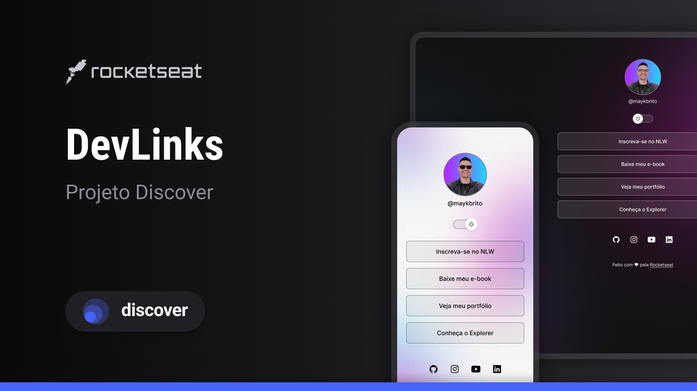

# Página de Links

Projeto front-end de uma página pessoal de links, desenvolvido com **HTML5, CSS3 e JavaScript**, baseado nos conteúdos educacionais da [Rocketseat](https://www.rocketseat.com.br/).

A página apresenta um perfil com links para conteúdos externos e redes sociais, além de permitir alternar entre os temas claro e escuro.



## Funcionalidades

- Exibição de foto de perfil e nome de usuário.
- Links para páginas e conteúdos externos.
- Ícones de acesso às redes sociais: GitHub, Instagram, YouTube e LinkedIn.
- Alternância entre os temas claro e escuro por meio de um botão interativo.
- Alteração dinâmica da imagem de perfil conforme o tema selecionado.
- Personalização visual com variáveis CSS.
- Efeitos visuais de interação nos links.

## Tecnologias utilizadas

- **Figma** 
- **HTML5** 
- **CSS3**
- **JavaScript**
- **Git e GitHub**

## Estrutura do projeto

```text
projeto/
├── index.html
├── style.css
├── script.js
└── assets/
    ├── avatar.png
    ├── avatar-light.png
    ├── bg-mobile.jpg
    ├── bg-mobile-light.jpg
    ├── MoonStars.svg
    └── Sun.svg
```

Os arquivos de imagens e ícones devem estar disponíveis no diretório `assets/`, conforme os caminhos utilizados no HTML e no CSS.

## Como executar

1. Clone o repositório:

   ```bash
   git clone https://github.com/ericlbc/discover
   ```

2. Entre na pasta do projeto:

   ```bash
   cd discover
   ```

3. Abra o arquivo `index.html` em um navegador.

Durante o desenvolvimento, também é possível utilizar a extensão **Live Server** no Visual Studio Code para visualizar as alterações em tempo real.

## Alternância de temas

A alternância entre os temas é implementada pela função `toggleMode()`, definida no arquivo `script.js`.

Ao acionar o botão, o JavaScript alterna a classe `light` no elemento raiz do documento HTML. Essa classe modifica as variáveis CSS responsáveis pelas cores, pela imagem de fundo e pelo ícone do botão.

A função também altera a imagem do perfil, utilizando `avatar-light.png` no tema claro e `avatar.png` no tema escuro.

## Conceitos praticados

- Estruturação de páginas com HTML.
- Seletores, propriedades e variáveis CSS.
- Uso de Flexbox para organização dos elementos.
- Posicionamento com `position: relative` e `position: absolute`.
- Pseudo-classe `:hover` para efeitos de interação.
- Manipulação do DOM com JavaScript.
- Uso de `classList.toggle()` e `classList.contains()`.
- Seleção de elementos com `document.querySelector()`.
- Alteração de atributos HTML com `setAttribute()`.

## Créditos

Projeto desenvolvido para fins de estudo e baseado nos conteúdos educacionais da [Rocketseat](https://www.rocketseat.com.br/).

---

Desenvolvido como parte dos estudos de desenvolvimento front-end.
